# waterpipe.js - smoky backgrounds generator (HTML5 Canvas)

waterpipe.js is a vanilla JavaScript library for smoky backgrounds developed by [dragdropsite.com](http://www.dragdropsite.com)

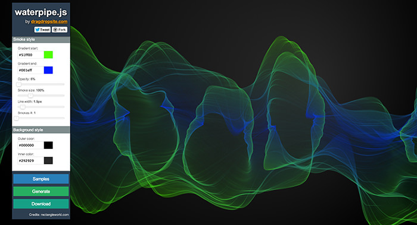

## Examples

Here are some examples generated using waterpipe.js:

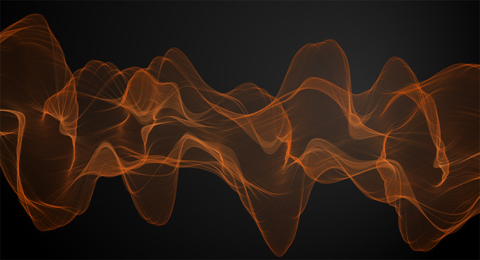
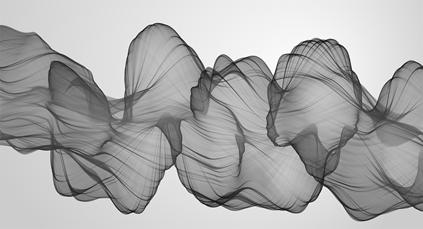

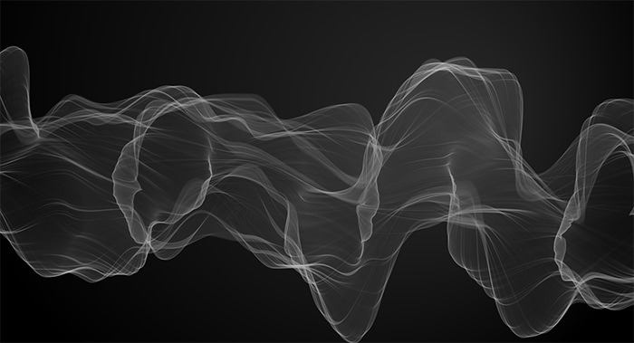
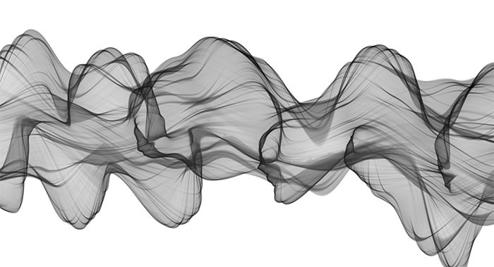
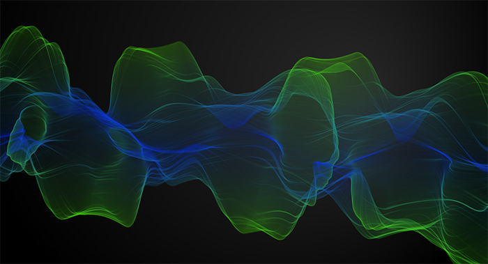
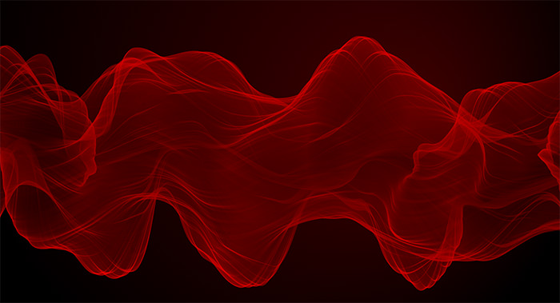
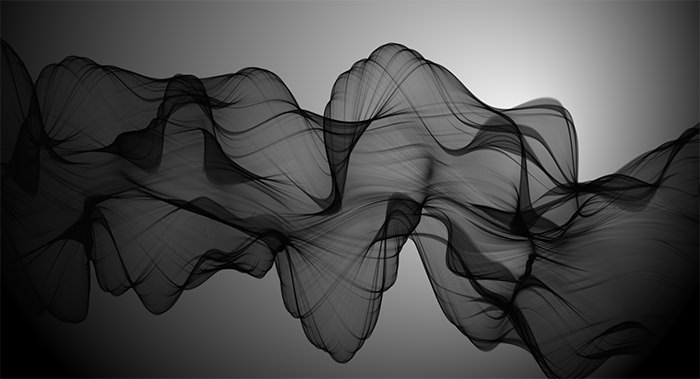
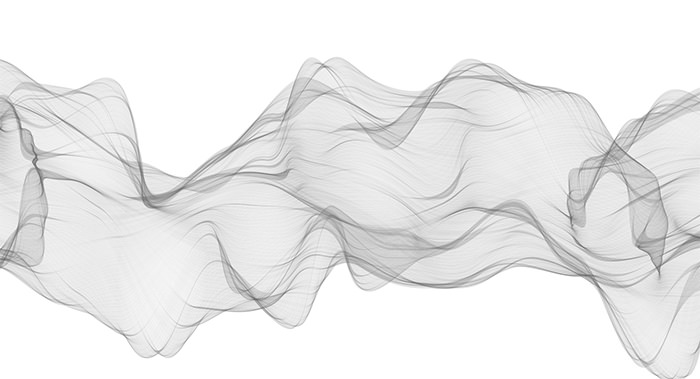
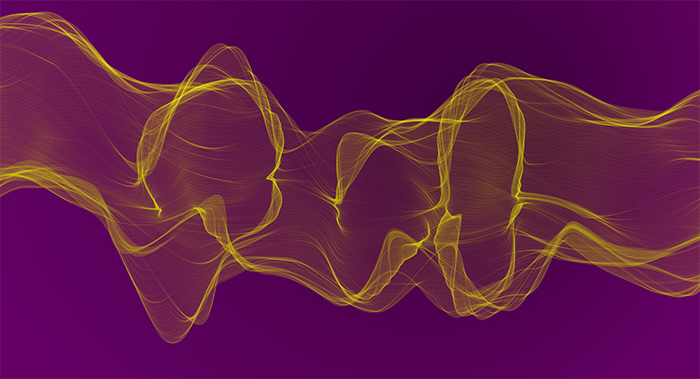
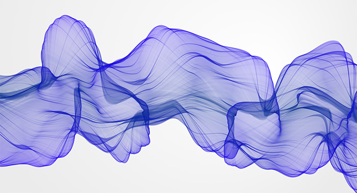
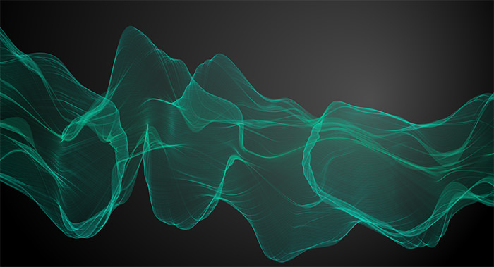

## Options

| Option        | Type          | Default   | Description                                                                                                                                                                    |
| ------------- | ------------- | --------- | ------------------------------------------------------------------------------------------------------------------------------------------------------------------------------ |
| gradientStart | string        | '#000000' | Gradient start color in hex format.                                                                                                                                            |
| gradientEnd   | string        | '#222222' | Gradient end color in hex format.                                                                                                                                              |
| smokeOpacity  | number        | 0.1       | Smoke opacity 0 to 1.                                                                                                                                                          |
| numCircles    | int           | 1         | Number of circles (smokes).                                                                                                                                                    |
| maxMaxRad     | int or 'auto' | 'auto'    | Could be used to change circle radius size                                                                                                                                     |
| minMaxRad     | int or 'auto' | 'auto'    | Could be used to change circle radius size                                                                                                                                     |
| minRadFactor  | int           | 0         | It's a factor representing the size of the smallest radius with respect to the largest possible. Integer from 0 to 1.                                                          |
| iterations    | int           | 8         | The number of subdividing steps to take when creating a single fractal curve. Can use more, but anything over 10 (thus 1024 points) is overkill for a moderately sized canvas. |
| drawsPerFrame | int           | 10        | Number of curves to draw on every tick of the timer                                                                                                                            |
| lineWidth     | number        | 2         | Line width                                                                                                                                                                     |
| speed         | int           | 1         | Drawing speed (tick of timer in ms)                                                                                                                                            |
| bgColorInner  | string        | '#ffffff' | Background outer color in hex format                                                                                                                                           |
| bgColorOuter  | string        | '#666666' | Background inner color in hex format                                                                                                                                           |

## Methods

The following code could be used to call a method: `smokyBG.generate();`

| Method    | Arguments   | Description                                                                                     |
| --------- | ----------- | ----------------------------------------------------------------------------------------------- |
| generate  |             | Generates background canvas                                                                     |
| setOption | optionName, | Set a new value to an option. Please check the above table for possible option names and values |
|           | optionValue |                                                                                                 |
| download  | width: int, | Download size in pixels                                                                         |
|           | height: int |                                                                                                 |

## Credits

[rectangleworld.com](http://rectangleworld.com/blog/) - big part of code has been taken from the examples provided on this blog
[dragdropsite](http://dragdropsite.github.io/waterpipe.js) - the original code, this project is fork made with React + Vite

## License

Licensed under MIT license
